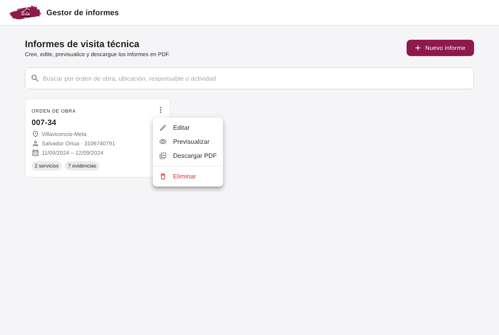
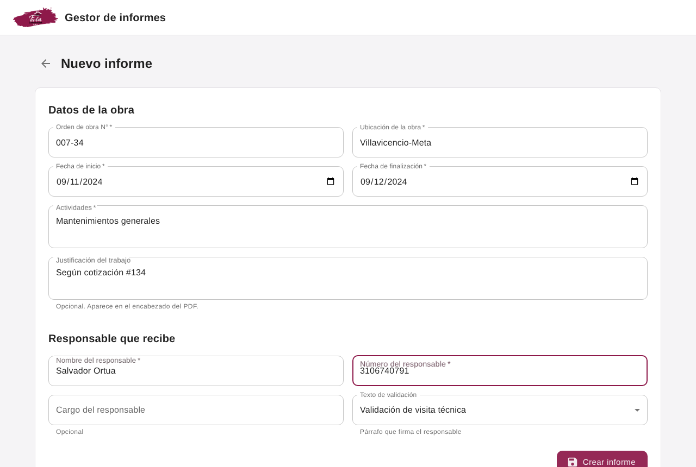
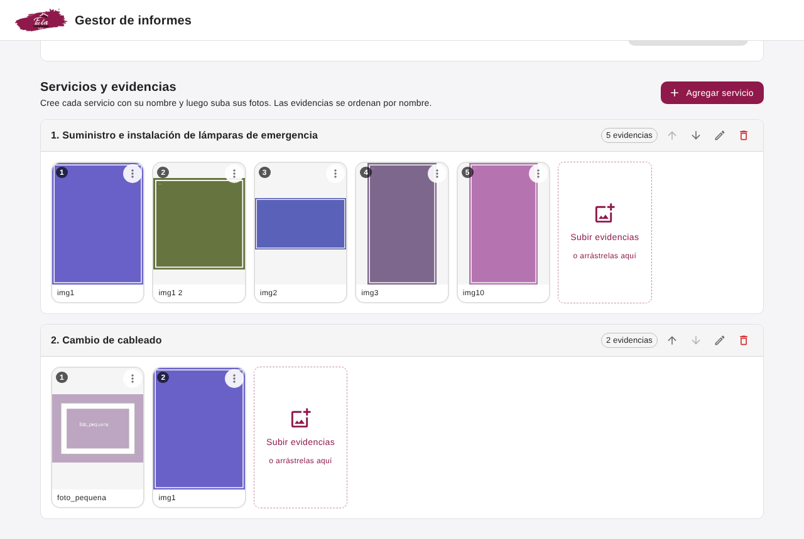
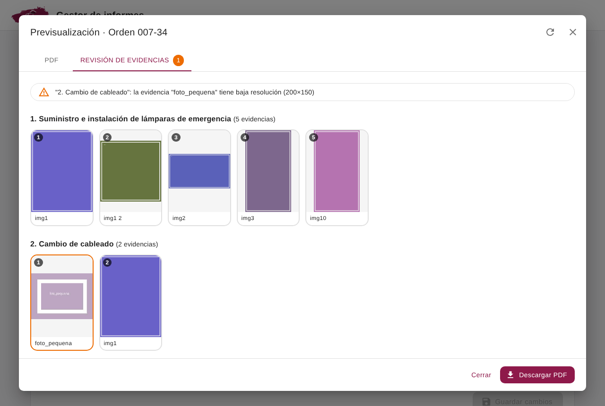
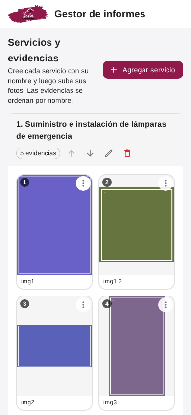
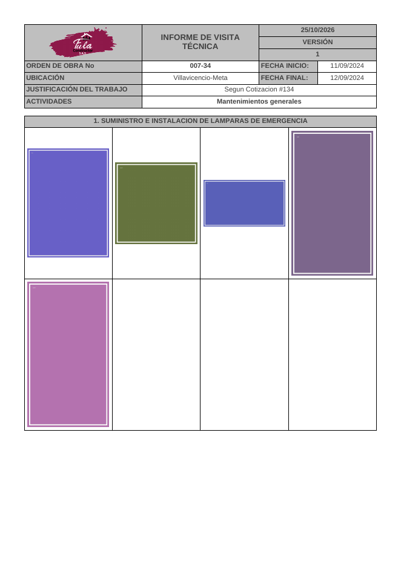
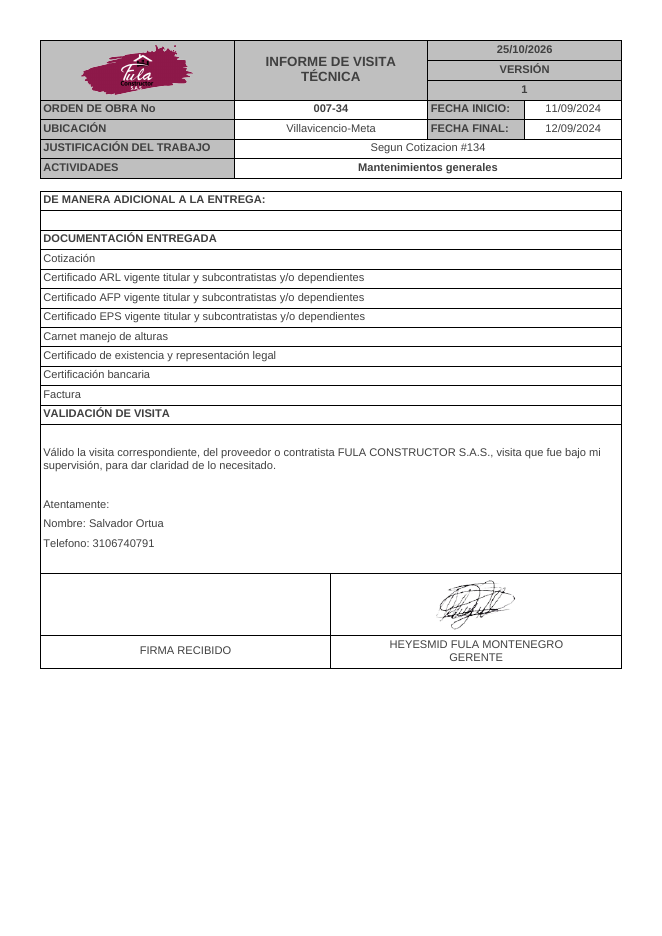
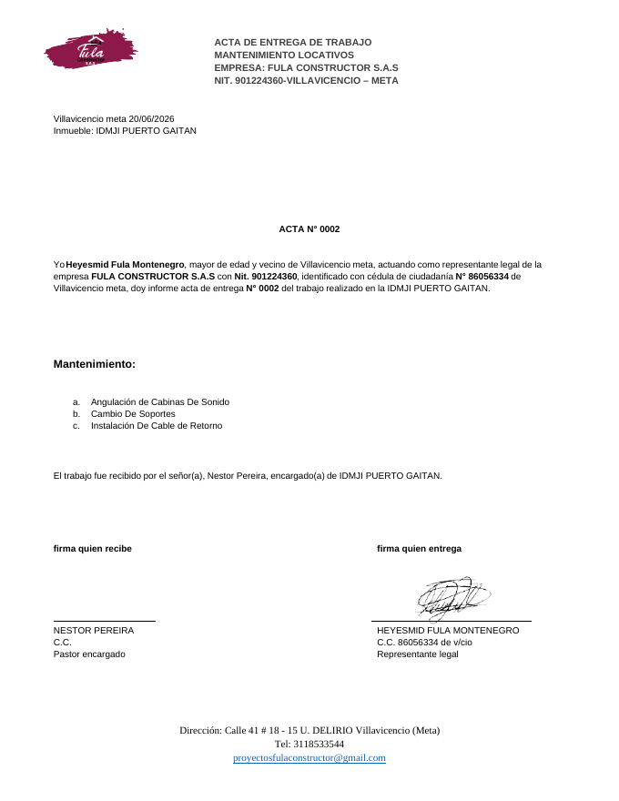

# Gestor de informes · Fula Constructor S.A.S.

Aplicación web para crear los **informes de visita técnica** y las **actas de entrega** de Fula Constructor S.A.S.:
se registran los datos de la obra, se cargan las fotos de evidencia de cada servicio realizado, se revisa que todo
esté bien y se descargan en **PDF** el informe (misma plantilla que la aplicación de escritorio en Java) y el acta
de entrega con su **consecutivo automático**.

Los datos se guardan en la nube (**Supabase**): un informe creado en el celular aparece al instante en el
computador y en cualquier otro dispositivo que ingrese con una cuenta autorizada.

**Aplicación publicada:** <https://fuladev.github.io/Gestor_de_informes/>  (GitHub Pages, rama `gh-pages`)



---

## Contenido

1. [Funcionalidades](#funcionalidades)
2. [Guía de uso](#guía-de-uso)
3. [El PDF generado](#el-pdf-generado)
4. [Acta de entrega](#acta-de-entrega)
5. [Revisión antes de descargar](#revisión-antes-de-descargar)
6. [Acceso y usuarios](#acceso-y-usuarios)
7. [¿Dónde se guardan los datos?](#dónde-se-guardan-los-datos)
8. [Instalación y ejecución](#instalación-y-ejecución)
9. [Publicar la aplicación](#publicar-la-aplicación)
10. [Personalización](#personalización)
11. [Arquitectura del código](#arquitectura-del-código)
12. [Tecnologías](#tecnologías)
13. [Preguntas frecuentes](#preguntas-frecuentes)

---

## Funcionalidades

| Módulo | Qué permite |
| --- | --- |
| **Informes** | Crear, listar, buscar, editar y eliminar informes. |
| **Servicios** | Agregar los servicios prestados en la obra, renombrarlos, reordenarlos y eliminarlos. |
| **Evidencias** | Subir varias fotos a la vez (botón o arrastrar y soltar), verlas en grande, renombrarlas, reemplazarlas y eliminarlas. |
| **Previsualización** | Ver el informe y el acta exactamente como se van a descargar, y una revisión automática de errores. |
| **Descarga** | Descargar el **informe PDF** o el **acta de entrega** desde el menú **⋮** de cada informe o desde el editor. |
| **Acta de entrega** | Cada informe recibe automáticamente un número de acta consecutivo (0001, 0002, …). |
| **Nube** | Los informes y fotos se guardan en Supabase y se sincronizan en vivo entre dispositivos. |
| **Acceso** | Solo ingresan las personas con correo autorizado por la empresa. |

Datos que se registran por cada informe:

| Campo | Obligatorio | Dónde aparece en el PDF |
| --- | :---: | --- |
| Orden de obra N° | ✅ | Encabezado de todas las páginas |
| Ubicación de la obra | ✅ | Encabezado |
| Fecha de inicio | ✅ | Encabezado |
| Fecha de finalización | ✅ | Encabezado (debe ser igual o posterior a la de inicio) |
| Actividades | ✅ | Encabezado |
| Justificación del trabajo | — | Encabezado (p. ej. “Según cotización #134”) |
| Nombre del responsable | ✅ | Validación de visita (“Nombre: …”) |
| Número del responsable | ✅ | Validación de visita (“Telefono: …”) |
| Cargo del responsable | — | Validación de visita (“Cargo: …”), solo si se llena |
| Texto de validación | ✅ | Párrafo que firma el responsable (ver [abajo](#página-final)) |

---

## Guía de uso

### 1. Crear el informe

En la pantalla principal pulse **Nuevo informe** y llene los datos de la obra y del responsable que recibe.
Los campos obligatorios están marcados con `*`; si falta alguno, se resalta en rojo al guardar.



Pulse **Crear informe**. A partir de ese momento se habilita la sección de servicios.

### 2. Agregar servicios y subir evidencias

Cada servicio se crea **primero con su nombre** (por ejemplo *“Suministro e instalación de lámparas de
emergencia”*) y **después** se le suben sus fotos:

1. Pulse **Agregar servicio**, escriba el nombre y pulse **Crear**.
2. En la tarjeta del servicio pulse **Subir evidencias** (puede seleccionar varias fotos a la vez) o arrastre las
   fotos sobre la tarjeta.
3. Repita para cada servicio.



**Orden de las evidencias.** Las fotos se ordenan automáticamente **por nombre, en orden natural**, que es como
las ordena una persona:

```
img1  →  img1 2  →  img2  →  img3  →  img10
```

(y no `img1, img10, img2` como haría un orden alfabético simple). El nombre de la evidencia es, por defecto, el
nombre del archivo sin la extensión. Para cambiar la posición de una foto, **renómbrela** desde su menú **⋮**.
El número que aparece en la esquina de cada foto es la posición que tendrá en el PDF.

**Acciones de cada servicio** (iconos en la barra gris):

| Icono | Acción |
| :---: | --- |
| ↑ ↓ | Subir o bajar el servicio (cambia la numeración 1., 2., 3. … del PDF) |
| ✏️ | Renombrar el servicio |
| 🗑️ | Eliminar el servicio y todas sus evidencias (pide confirmación) |

**Acciones de cada evidencia** (menú **⋮** sobre la foto): *Ver*, *Renombrar*, *Reemplazar imagen* y *Eliminar*.

**Validación al subir.** Cada foto se revisa al cargarla. Si un archivo no es una imagen, está dañado o tiene un
formato que el navegador no puede leer (por ejemplo **HEIC** de iPhone en navegadores que no lo soportan), se
rechaza y se muestra un aviso indicando cuál fue. Las demás fotos del lote sí se cargan.

### 3. Previsualizar

Pulse **Previsualizar** (en el editor o en el menú **⋮** del listado). Se abre una ventana con dos pestañas:

- **PDF**: el documento tal cual se va a descargar.
- **Revisión de evidencias**: la lista de problemas encontrados y todas las fotos de cada servicio en el orden
  en que saldrán. Las fotos con problemas aparecen con borde rojo (error) o naranja (advertencia).



Si corrige algo mientras la ventana está abierta, pulse el botón ⟳ para volver a generar la vista previa.

### 4. Descargar el PDF

Pulse **Descargar PDF**. El archivo se guarda con el nombre:

```
informe_<orden de obra>_<nombre del responsable>.pdf      →  informe_007-34_Salvador Ortua.pdf
```

Si la revisión encuentra **errores**, en lugar de descargar se abre la pestaña de revisión para que los corrija.
Si aun así necesita el documento, puede usar **Descargar de todas formas**.

### En el celular

La aplicación se adapta a pantallas pequeñas, así que se puede usar desde el celular en la obra y subir las fotos
directamente desde la cámara o la galería.



---

## El PDF generado

El PDF es tamaño **A4** y replica la plantilla de la aplicación de escritorio (iText):

| Página de servicio | Página final |
| :---: | :---: |
|  |  |

### Encabezado (en todas las páginas)

- Logo de la empresa, título **“INFORME DE VISITA TÉCNICA”**, fecha de generación del informe y **versión**.
- Orden de obra, ubicación, fecha de inicio y fecha final.
- Justificación del trabajo y actividades.

### Páginas de servicios

- Cada servicio empieza en una **página nueva**, con el título numerado (`1. NOMBRE DEL SERVICIO`).
- Las fotos se ubican en una grilla de **4 columnas**, y se agrega **una columna más por cada 10 fotos**
  (10–19 fotos → 5 columnas, 20–29 → 6, …), igual que la versión de escritorio.
- Cada foto se escala para caber en su celda sin deformarse.
- Si las fotos no caben en una página, el servicio continúa en la siguiente con el encabezado repetido y el
  título `… (continuación)`.

### Página final

- **Documentación entregada**: cotización, certificados ARL / AFP / EPS, carnet de alturas, certificado de
  existencia y representación legal, certificación bancaria y factura.
- **Validación de visita**, con uno de estos dos textos según lo elegido en el formulario:
  - *Validación de visita técnica*: “Válido la visita correspondiente, del proveedor o contratista FULA CONSTRUCTOR
    S.A.S., visita que fue bajo mi supervisión, para dar claridad de lo necesitado.”
  - *Recibido a satisfacción*: “Recibí a satisfacción los bienes, obras y/o servicios relacionados en la orden de
    servicio N° … de fecha …”, más la línea **Fecha de recibido** (fecha de finalización).
- Nombre, teléfono y (si se llenó) cargo del responsable.
- Casillas de **firma recibido** y firma del gerente.

---

## Acta de entrega

Cada informe tiene su **acta de entrega** en PDF (tamaño carta), con la misma plantilla de
`ACTA_DE_ENTREGA.pdf`. No hay que llenar nada adicional: todo sale del formulario del informe.

### Consecutivo automático

- Al **crear** un informe, la base de datos le asigna el siguiente número de acta: el primero es `0001`, luego
  `0002`, `0003`, …
- El número lo genera **Supabase**, no el navegador, así que dos personas creando informes al mismo tiempo en
  dispositivos distintos nunca reciben el mismo número.
- El número **no se puede editar** ni se reutiliza: si se elimina un informe, su número queda libre pero no se
  vuelve a asignar (igual que un talonario).
- Se ve en el listado (`Acta N° 0002`), en el encabezado del editor y en la pestaña del acta de la
  previsualización. También se puede buscar por número.

### De dónde sale cada dato

| En el acta | Dato del informe |
| --- | --- |
| `Villavicencio meta 20/06/2026` | Fecha de finalización |
| `Inmueble: …` y “trabajo realizado en la …” | Ubicación de la obra |
| `ACTA N° 0193` | Consecutivo automático |
| Lista `a.`, `b.`, `c.` bajo “Mantenimiento:” | Nombres de los servicios, en su orden (si no hay servicios, las actividades) |
| “El trabajo fue recibido por el señor(a) …” y firma de quien recibe | Nombre del responsable |
| Cargo bajo la firma de quien recibe (p. ej. “Pastor encargado”) | Cargo del responsable |
| Representante legal, NIT, cédula, firma, dirección, teléfono y correo | Datos fijos en `src/config.ts` → `ACTA` |



El acta se descarga con el nombre `acta_entrega_<consecutivo>_<orden de obra>.pdf`, por ejemplo
`acta_entrega_0002_084-183.pdf`.

---

## Revisión antes de descargar

La revisión automática detecta lo siguiente:

| Verificación | Nivel |
| --- | :---: |
| Faltan datos obligatorios o la fecha final es anterior a la de inicio | 🔴 Error |
| El informe no tiene ningún servicio | 🔴 Error |
| Un servicio no tiene evidencias | 🔴 Error |
| Una evidencia está dañada y no se puede leer | 🔴 Error |
| Una evidencia tiene baja resolución (lado menor < 300 px) | 🟠 Advertencia |
| Una evidencia no tiene nombre | 🟠 Advertencia |
| Hay nombres de evidencia repetidos dentro de un mismo servicio | 🟠 Advertencia |

Los **errores** impiden la descarga directa del informe (se abre la revisión). Las **advertencias** solo informan.
El acta de entrega no lleva fotos, así que solo exige que los datos obligatorios del formulario estén completos.

---

## Acceso y usuarios

La aplicación está publicada en internet, por eso **pide iniciar sesión** con correo y contraseña.

- Solo pueden **crear cuenta** los correos que estén en la lista de **miembros autorizados**. Si alguien intenta
  registrarse con otro correo, la base de datos lo rechaza.
- Todos los miembros ven y editan **los mismos informes** (es el espacio de trabajo de la empresa).
- La protección está en la base de datos (políticas *Row Level Security* de Supabase y un bucket privado para las
  fotos), no solo en la pantalla: sin una sesión de un miembro no se puede leer ni modificar nada.


**Primera vez:** en la pantalla de ingreso elija *“Primera vez: crear mi cuenta”*, escriba su correo autorizado y
una contraseña, y confirme el correo que le llega. Después ingrese normalmente. Si olvida la contraseña, use
*“Olvidé mi contraseña”*.

**Agregar o quitar personas** (desde el panel de Supabase → *SQL Editor*):

```sql
-- autorizar a una persona (el correo en minúsculas)
insert into public.miembros (email) values ('persona@empresa.com');

-- quitarle el acceso
delete from public.miembros where email = 'persona@empresa.com';
```

Quien sale de la lista deja de ver los informes inmediatamente, aunque su cuenta siga existiendo.

---

## Instalación y ejecución

Requisitos: **Node.js 20** o superior y npm. La conexión a Supabase se configura en el archivo `.env`
(`VITE_SUPABASE_URL` y `VITE_SUPABASE_PUBLISHABLE_KEY`). La clave publicable es pública por diseño: va incluida en
la aplicación y el acceso a los datos lo controlan el login y las políticas de seguridad.

```bash
git clone <url-de-este-repositorio>
cd gestor-informes-web
npm install
npm run dev
```

Abra <http://localhost:5173> en el navegador.

| Comando | Descripción |
| --- | --- |
| `npm run dev` | Servidor de desarrollo con recarga automática |
| `npm run build` | Compila la versión de producción en la carpeta `dist/` |
| `npm run preview` | Sirve localmente la versión compilada para probarla |
| `npm run lint` | Revisa el código con oxlint |

---

## Publicar la aplicación

`npm run build` genera en `dist/` una aplicación **estática** (HTML, JS e imágenes). Usa rutas relativas y
navegación con `#`, así que se puede publicar en cualquier hosting estático sin configuración adicional:

- **GitHub Pages** (así está publicada hoy): el contenido de `dist/` vive en la rama `gh-pages` del repositorio y
  *Settings → Pages* está configurado como *Deploy from a branch → `gh-pages` / `(root)`*. Para publicar una
  versión nueva:

  ```bash
  npm run build
  touch dist/.nojekyll
  cd dist && git init -b gh-pages && git add -A && git commit -m "Deploy"
  git push -f https://github.com/Fuladev/Gestor_de_informes.git gh-pages
  ```
- **Netlify / Vercel / Cloudflare Pages**: comando de build `npm run build`, carpeta de publicación `dist`.
- **Servidor propio**: copie `dist/` a cualquier carpeta servida por Apache, Nginx, IIS, etc.

---

## ¿Dónde se guardan los datos?

Todo se guarda en el proyecto de Supabase **`gestor-informes`**:

| Qué | Dónde |
| --- | --- |
| Informes, servicios y datos de cada evidencia | Base de datos Postgres (tablas `informes`, `servicios`, `evidencias`) |
| Fotos de evidencia | Supabase Storage, bucket privado `evidencias` |
| Usuarios | Supabase Auth; lista de autorizados en la tabla `miembros` |
| Consecutivo de actas | Secuencia `acta_consecutivo_seq` |

- ✅ Los informes se ven desde **cualquier dispositivo** con una cuenta autorizada, y los cambios aparecen en vivo
  en los demás dispositivos abiertos.
- ✅ Borrar los datos del navegador o cambiar de celular **no** borra los informes.
- ⚠️ Se necesita conexión a internet para trabajar.
- Las fotos se reducen automáticamente a un máximo de **1600 px** por lado y se guardan en JPEG, para que suban
  rápido desde el celular y el PDF quede liviano.

**Informes de la versión anterior.** La primera versión de la app guardaba los informes solo en el navegador. Si
un dispositivo todavía tiene informes así, al ingresar aparece el aviso *“Hay N informe(s) guardado(s) solo en
este dispositivo”* con el botón **Subir a la nube**: los sube con sus fotos (asignándoles número de acta) y los
borra del navegador.

El esquema de la base de datos está en [`supabase/migrations/`](supabase/migrations).

---

## Personalización

| Qué cambiar | Dónde |
| --- | --- |
| Nombre de la empresa, del gerente, su cargo, título del informe y versión | `src/config.ts` → `COMPANY` |
| Lista de “Documentación entregada” | `src/config.ts` → `DOCUMENTACION_ENTREGADA` |
| Datos fijos del acta (representante legal, NIT, cédula, dirección, teléfono, correo) | `src/config.ts` → `ACTA` |
| Texto y posiciones del acta de entrega | `src/lib/acta.ts` |
| Logo del encabezado | `src/assets/logo.png` |
| Firma del gerente | `src/assets/firma.png` |
| Textos de la validación de visita | `src/lib/pdf.ts` → método `closing()` |
| Color principal de la aplicación | `src/theme.ts` |
| Tamaño máximo de las fotos guardadas | `src/lib/images.ts` → `MAX_SIDE` |

Después de cualquier cambio ejecute `npm run build` para generar una nueva versión.

---

## Arquitectura del código

```
src/
├── main.tsx                 Punto de entrada: tema, caché de datos, notificaciones y enrutador
├── App.tsx                  Sesión, barra superior y rutas
├── theme.ts                 Tema de Material UI (colores de la marca)
├── config.ts                Datos fijos de la plantilla del PDF
├── types.ts                 Modelos de datos: Report, Service, Evidence
├── api.ts                   Todas las operaciones CRUD contra Supabase (tablas y Storage)
├── pages/
│   ├── LoginPage.tsx        Ingreso, creación de cuenta y recuperación de contraseña
│   ├── ReportsPage.tsx      Listado, búsqueda y menú de acciones de los informes
│   └── ReportEditorPage.tsx Crear/editar un informe y sus servicios
├── components/
│   ├── ReportForm.tsx       Formulario de datos de la obra y del responsable
│   ├── ServicesEditor.tsx   Lista de servicios del informe
│   ├── ServiceCard.tsx      Un servicio: subida de fotos, reordenar, renombrar, eliminar
│   ├── EvidenceTile.tsx     Una evidencia: ver, renombrar, reemplazar, eliminar
│   ├── EvidenceThumb.tsx    Miniatura con número de posición
│   ├── PreviewDialog.tsx    Previsualización (informe, acta y revisión)
│   ├── ReportActionsMenu.tsx Menú ⋮ (editar, previsualizar, descargar informe/acta, eliminar)
│   ├── LocalImportBanner.tsx Aviso para subir informes de la versión anterior
│   ├── Dialogs.tsx          Diálogos de confirmación y de texto
│   └── NotifyProvider.tsx   Mensajes emergentes
├── hooks/
│   ├── queries.ts           Consultas con caché (React Query) y ejecución de cambios
│   ├── useRealtimeSync.ts   Refresca la pantalla cuando otro dispositivo cambia datos
│   ├── useSession.ts        Sesión de Supabase Auth
│   ├── useReportPdf.tsx     Lógica compartida de previsualizar y descargar
│   ├── useObjectUrl.ts      URLs temporales para mostrar imágenes y PDF
│   └── useNotify.ts         Acceso a los mensajes emergentes
├── lib/
│   ├── supabase.ts          Cliente de Supabase
│   ├── pdf.ts               PDF del informe con jsPDF (réplica de la plantilla iText)
│   ├── acta.ts              PDF del acta de entrega (réplica de ACTA_DE_ENTREGA.pdf)
│   ├── pdfAssets.ts         Utilidades compartidas por los dos PDF
│   ├── localLegacy.ts       Lectura de los informes de la versión anterior (solo navegador)
│   ├── images.ts            Validación, reducción y conversión de fotos a JPEG
│   ├── validation.ts        Validación del formulario y revisión previa a la descarga
│   ├── sort.ts              Orden natural de evidencias (img1, img1 2, img2, img10)
│   ├── format.ts            Formato de fechas, consecutivo y nombres de archivo
│   └── emptyReport.ts       Valores iniciales del formulario
└── assets/                  Logo y firma usados en los PDF
supabase/migrations/         Esquema de la base de datos, seguridad y bucket de fotos
```

### Modelo de datos

```
Report (informe)                        tabla informes
 ├─ actaNumero (consecutivo, lo asigna la base de datos)
 ├─ ordenObra, ubicacion, actividades, justificacion
 ├─ responsableNombre, responsableTelefono, responsableCargo
 ├─ fechaInicio, fechaFin, tipoValidacion
 └─ Service[] (servicios, ordenados por `posicion`)
      ├─ nombre, posicion
      └─ Evidence[] (fotos, ordenadas por `nombre` en orden natural)
           └─ nombre, storagePath (JPEG en Storage), width, height, originalName
```

Al eliminar un informe se eliminan sus servicios, evidencias y fotos; al eliminar un servicio se eliminan sus
evidencias y se renumeran los demás.

### Flujo de generación del PDF

1. `getFullReport(id)` lee el informe con sus servicios y evidencias ya ordenados.
2. `reviewReport()` revisa datos y evidencias y produce la lista de errores y advertencias.
3. `buildReportPdf()` dibuja el documento con jsPDF: encabezado, una página por servicio con su grilla de
   fotos y la página final. El módulo del PDF se carga **solo cuando se necesita**, para que la aplicación abra
   más rápido.

---

## Tecnologías

| Tecnología | Uso |
| --- | --- |
| [React 19](https://react.dev) + [TypeScript](https://www.typescriptlang.org) | Interfaz de usuario |
| [Vite](https://vite.dev) | Servidor de desarrollo y compilación |
| [Material UI](https://mui.com) | Componentes visuales (formularios, menús, diálogos) |
| [React Router](https://reactrouter.com) | Navegación entre pantallas |
| [Supabase](https://supabase.com) | Base de datos Postgres, autenticación, almacenamiento de fotos y tiempo real |
| [TanStack Query](https://tanstack.com/query) | Caché y actualización de los datos en pantalla |
| [jsPDF](https://github.com/parallax/jsPDF) | Generación del PDF |

---

## Preguntas frecuentes

**¿Funciona en el celular?**
Sí. La interfaz se adapta a pantallas pequeñas y las fotos se pueden subir desde la cámara o la galería. En
algunos celulares la vista previa del PDF no se muestra dentro de la ventana; en ese caso use el enlace *“ábralo
en una pestaña nueva”*.

**Una foto del iPhone no se pudo subir.**
Las fotos en formato HEIC solo las lee Safari. Desde otros navegadores, configure la cámara del iPhone en
*Ajustes → Cámara → Formatos → Más compatible* (JPEG) o comparta la foto como JPEG.

**¿Cómo cambio el orden de las fotos?**
Las fotos se ordenan por nombre. Renómbrelas desde el menú **⋮** de cada foto, por ejemplo `img1`, `img2`,
`img3`… El número en la esquina de la miniatura muestra la posición final.

**¿Cómo cambio el orden de los servicios?**
Con las flechas ↑ ↓ de la barra de cada servicio.

**¿Qué fecha aparece arriba a la derecha del PDF?**
La fecha del día en que se genera el PDF, igual que en la versión de escritorio.

**¿Puedo cambiar el número de un acta?**
No. El consecutivo lo asigna la base de datos al crear el informe para garantizar que nunca se repita. Si
necesita que la numeración arranque en otro número (por ejemplo para continuar la del talonario en papel), en el
*SQL Editor* de Supabase ejecute `alter sequence public.acta_consecutivo_seq restart with 194;` antes de crear el
siguiente informe.

**Me dice que mi correo no está autorizado.**
Pida al administrador que lo agregue a la lista de miembros (ver [Acceso y usuarios](#acceso-y-usuarios)).

**No me llegó el correo de confirmación.**
Revise la carpeta de spam. El servicio de correo incluido en Supabase tiene un límite de pocos correos por hora;
si se alcanza, espere un rato y vuelva a intentarlo.
